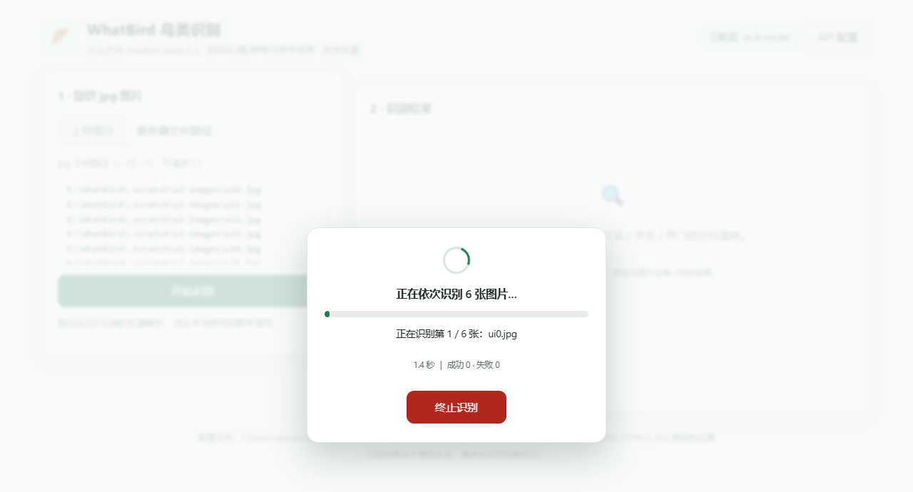
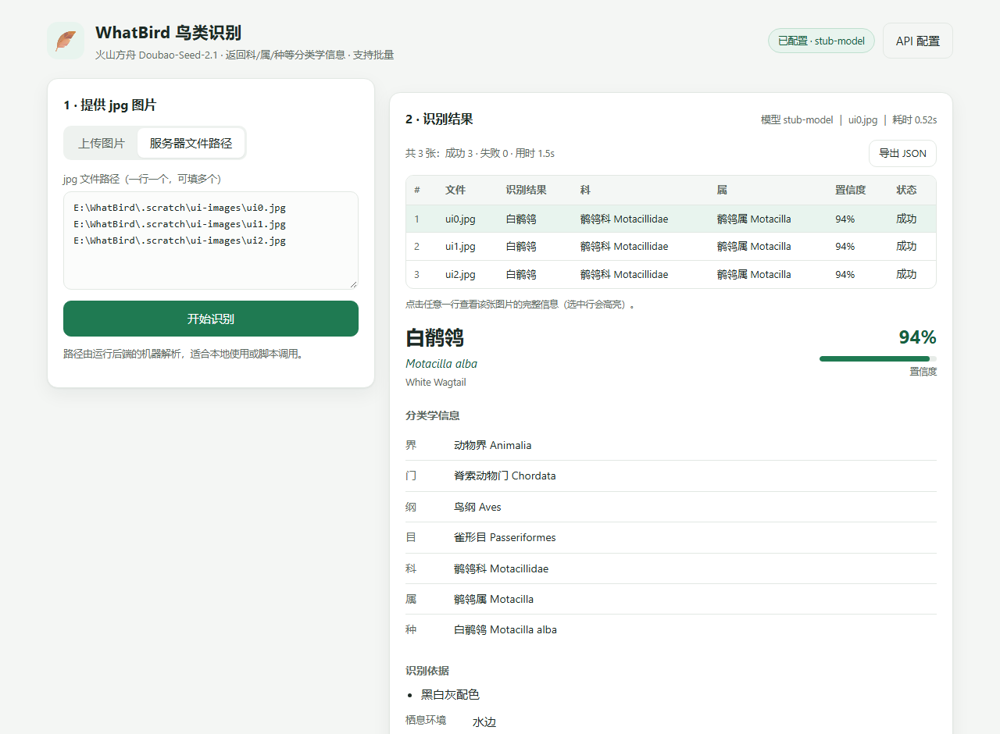

# WhatBird 🪶

基于 **火山引擎方舟 Doubao-Seed-2.1** 的鸟类识别应用：给一张（或一批）jpg 图片，返回鸟的中文名、英文名、
拉丁学名，以及**界 / 门 / 纲 / 目 / 科 / 属 / 种**等完整分类学信息。

支持**批量识别**：一次选择多张图片依次识别，界面显示进度（当前第几张 / 共几张）并给出**终止**按钮，
结果以表格列出，可点击查看单张详情、导出 JSON。

另外提供两项**纯本地**能力（不联网、不消耗额度、不需要 API Key）：

- **对焦点分析**：用**传统图形学算法**（改进拉普拉斯清晰度图 + Otsu 合焦区域 + 区域锐度加权质心）
  找出画面里实际最清晰的位置，同时读取相机写进 EXIF 的对焦点，**两条路线都上报**并在原图上标注。
  算法细节见 [`docs/focus-algorithm.md`](docs/focus-algorithm.md)。
- **鸟类位置检测**：用 **YOLO**（可选依赖 ultralytics + torch）找出画面里**每一只鸟的位置**（框 + 置信度），
  并在原分辨率图上画框标注；优先使用 **Intel 显卡（XPU）** 加速，不可用时自动退回 CPU。
  详见 [`docs/bird-detection.md`](docs/bird-detection.md)。

项目约定见 [`Agent.md`](Agent.md)（固定载入内容）：Python 工作语言、pip 用清华镜像、
前后端分离、git 版本管理、API 配置隔离且不入库。

---

## 1. 架构

严格的前后端分离，所有业务能力集中在 `core` 层，CLI 与 Web 都只是 `core` 的调用方：

```
        ┌──────────────┐        ┌──────────────┐
        │  CLI (前端)  │        │  Web (前端)  │
        │ whatbird/cli │        │ 静态 HTML/JS │
        └──────┬───────┘        └──────┬───────┘
               │   CLI -> core         │  REST -> core
               │                       │
        ┌──────▼───────────────────────▼───────┐
        │            whatbird/core             │
        │ config / image_input / prompt /      │
        │ ark_client / recognizer / models     │
        │ focus/   (对焦点分析，纯本地)          │
        │ detect/  (鸟类位置检测，本地 YOLO)     │
        └──────────────────┬───────────────────┘
                           │ OpenAI 兼容协议
                  ┌────────▼────────┐
                  │  火山方舟 Ark    │
                  │ Doubao-Seed-2.1 │
                  └─────────────────┘
```

- `whatbird/core` —— 纯业务，不 import 任何 Web 框架；未来接新的 UI（桌面端、Bot…）只需再写一个前端。
- `whatbird/core/focus/` —— 对焦点分析（EXIF 路线 + 传统图形学内容分析路线），**不联网**。
- `whatbird/core/detect/` —— 鸟类位置检测（YOLO，Intel 显卡优先），**不联网**、按需下载权重。
- `whatbird/cli.py` —— 命令行前端（`CLI -> core`）。
- `whatbird/web/` —— FastAPI REST 后端 + 静态前端（`UI -> core`）。

```
WhatBird/
├── Agent.md                     # 固定载入约定
├── README.md
├── requirements.txt             # 运行依赖（识别 + 对焦）
├── requirements-detect.txt      # 可选依赖（YOLO 位置检测，含安装顺序说明）
├── requirements-dev.txt         # 开发/测试依赖
├── pyproject.toml
├── examples/
│   └── config.example.json      # 配置模板（不含真实密钥，可提交）
├── samples/                     # 真实验证样张（不入库，见其 README）
├── docs/
│   ├── focus-algorithm.md       # 对焦点分析算法说明
│   ├── bird-detection.md        # 鸟类位置检测说明（模型 / 坐标 / 参数 / 边界）
│   └── screenshots/             # 界面截图（README 引用）
├── whatbird/
│   ├── core/
│   │   ├── config.py            # 配置读写 + 隔离 + 脱敏
│   │   ├── errors.py            # 统一异常体系
│   │   ├── image_input.py       # jpg 校验 / 压缩 / base64 / 转正
│   │   ├── prompt.py            # 提示词 + 模型输出解析
│   │   ├── ark_client.py        # 方舟调用（唯一的外部通信点）
│   │   ├── models.py            # 数据契约
│   │   ├── recognizer.py        # 门面 BirdRecognizer
│   │   ├── focus/               # 对焦点分析（门面 analyze_focus）
│   │   │   ├── models.py        #   结果数据契约
│   │   │   ├── content.py       #   内容分析（opencv，传统图形学）
│   │   │   ├── exif_focus.py    #   EXIF / MakerNote 对焦点读取
│   │   │   └── overlay.py       #   标注图渲染（Pillow）
│   │   └── detect/              # 鸟类位置检测（门面 detect_birds）
│   │       ├── models.py        #   结果数据契约 + 参数
│   │       ├── backend.py       #   ultralytics 适配层（唯一的重依赖点）
│   │       └── overlay.py       #   画框标注图渲染（Pillow）
│   ├── cli.py                   # CLI 前端
│   └── web/
│       ├── app.py               # FastAPI REST 层
│       ├── jobs.py              # 批量识别任务（进度 / 终止）
│       └── static/              # 原生 HTML/CSS/JS 前端
└── tests/                       # pytest（core / api / 前端契约）
```

---

## 2. 创建运行环境

在项目里创建虚拟环境（Windows cmd，依赖走清华镜像 —— `Agent.md` 第 2 条）：

```bat
cd /d E:\WhatBird
python -m venv .venv
.venv\Scripts\python -m pip install -i https://pypi.tuna.tsinghua.edu.cn/simple -r requirements-dev.txt
```

验证：

```bat
.venv\Scripts\python -m pytest                        :: 跑测试
.venv\Scripts\python -m whatbird.cli config doctor    :: 检查各配置位置是否可写
.venv\Scripts\python -m whatbird.cli serve            :: 启动网页端
```

下文命令里的 `python` 都指这个虚拟环境的解释器。也可以直接用仓库根目录的启动器
`whatbird.cmd`，它按下面的顺序挑解释器：

1. 环境变量 `WHATBIRD_PYTHON` 指定的解释器
2. 项目内 `.venv\Scripts\python.exe`
3. `%USERPROFILE%\whatbird-venv\Scripts\python.exe`
4. PATH 上的 `python`

> 三个已踩过的坑：
> 1. `requirements*.txt` 保持纯 ASCII —— 中文 Windows 上 pip 用 GBK 读取，中文注释会抛 `UnicodeDecodeError`。
> 2. pip 长时间卡住不动时加 `--no-cache-dir`（pip 缓存目录不可写时会一直空转）。
> 3. 保存配置报「拒绝访问」时，先跑 `whatbird config doctor`：它会逐个候选位置**真实试写**并报告原因；
>    必要时换一个解释器运行（`set WHATBIRD_PYTHON=<解释器完整路径>`）。
>
> ⚠ **不要把本项目装进系统 Python**：那会升级共享的 pydantic / Pillow，可能弄坏你机器上原有的包
> （本机就踩过：spacy 3.6 需要 pydantic v1、gradio 3.45 需要 Pillow < 11）。始终用独立 venv。
> 本机还踩过一次：在项目目录里直接用 `python -m pip install` —— 而 PATH 上排第一的是系统 Python，
> 于是包装进了系统解释器。**装依赖请始终写全路径** `.venv\Scripts\python.exe`，
> 或用 `\.venv\Scripts\Activate.ps1` 激活后再用 `python`。

### 可选：安装鸟类位置检测依赖

只有要用 `whatbird detect`（YOLO 找鸟的位置）时才需要。**按顺序三条命令**，原因见
[`requirements-detect.txt`](requirements-detect.txt) 与 [`docs/bird-detection.md`](docs/bird-detection.md)：

```bat
:: 1) torch / torchvision 必须来自 PyTorch 官方 XPU 源（默认源是 CPU 版，用不上 Intel 显卡）
.venv\Scripts\python.exe -m pip install -i https://download.pytorch.org/whl/xpu torch==2.8.0 torchvision==0.23.0

:: 2) ultralytics 必须加 --no-deps：它会用 GUI 版 opencv-python 顶掉本项目刻意选的 headless 版
.venv\Scripts\python.exe -m pip install -i https://pypi.tuna.tsinghua.edu.cn/simple --no-deps ultralytics==8.4.175

:: 3) 补齐 --no-deps 跳过的真正运行时依赖
.venv\Scripts\python.exe -m pip install -i https://pypi.tuna.tsinghua.edu.cn/simple pyyaml scipy psutil py-cpuinfo ultralytics-thop
```

装完验证（期望打印 `2.8.0+xpu True`）：

```bat
.venv\Scripts\python.exe -c "import torch;print(torch.__version__, torch.xpu.is_available())"
```

> 装完 pip 可能报 `ultralytics requires opencv-python / polars / nvidia-ml-py` —— 这是 `--no-deps`
> 的正常产物：`cv2` 已由 `opencv-python-headless` 提供（够用），`polars` / `nvidia-ml-py` 推理路径根本不会 import。


---

## 3. 配置 API（一次配置，长期有效）

### 配置存放在哪里

程序启动时会**真实试写**探测各候选位置，取第一个可写的（界面与 `config doctor` 都会显示结果）：

1. `~/.whatbird/config.json` —— 首选，完全在仓库之外；
2. `%LOCALAPPDATA%\WhatBird\config.json`；
3. `%APPDATA%\WhatBird\config.json`；
4. `<项目>\.whatbird\config.json` —— 仓库内的兜底位置，**必须由你显式同意才会使用**。

第 4 项有三重限制，避免密钥被悄悄放进项目：

- **默认不自动降级**。需要显式同意：向导第 4 步勾选「同意使用项目内位置」，
  或命令行 `whatbird config set --allow-project-config ...`，
  或设置环境变量 `WHATBIRD_ALLOW_PROJECT_CONFIG=1`；
- 必须通过 `git check-ignore` 校验才会启用，所以「不会被提交到 git」由 git 本身保证；
- **读取**不受影响：已经存在别处的配置仍会被读到（界面/CLI 会显示「当前读取自」），
  位置变化不会让你重填 Key。

不是首选位置时，界面和命令行都会明确提示当前用的是哪个位置、以及首选位置**为什么不可写**。

```bash
python -m whatbird.cli config doctor    # 逐个候选位置真实试写，排查「保存失败」
```

向导第 4 步有「重新检测位置」按钮（不必重启进程）；如果位置发生变化
（例如从项目内兜底切回用户目录），已配置的内容仍会被读取，下次保存写入新位置，**不需要重填 Key**。

配置入口有两个，读写的是**同一份文件**，效果完全相同。

### 方式一：Web 配置向导（推荐）

```bash
python -m whatbird.cli serve
```

打开 <http://127.0.0.1:8000>，**首次进入会自动弹出四步配置向导**：

1. **获取 Key** —— 直达方舟控制台的入口，说明需要开通的模型与推理接入点；
2. **接入信息** —— API Key、Base URL、模型 / 推理接入点 ID，带即时校验；
3. **高级参数** —— 超时、max_tokens、temperature、图片最长边、JPEG 质量，可一键恢复默认；
4. **测试并保存** —— 「测试连接」用当前填写的内容试调一次方舟且**不写盘**，确认无误再「保存配置」。


之后随时点右上角「API 配置」可重新进入向导；已保存的 Key 只以脱敏形式回显，留空即表示不修改。

### 方式二：命令行

推荐交互式输入 Key，避免留在命令历史里：

```bash
python -m whatbird.cli config set --api-key -
```

也可以一次写全：

```bash
python -m whatbird.cli config set ^
  --api-key sk-你的方舟APIKey ^
  --base-url https://ark.cn-beijing.volces.com/api/v3 ^
  --model doubao-seed-2-1-lite
```

> 在方舟控制台创建**推理接入点**后，`--model` 也可以填接入点 ID（形如 `ep-2025xxxx-xxxxx`）。

查看 / 校验：

```bash
python -m whatbird.cli config show      # 默认脱敏显示（含配置文件位置与可写性）
python -m whatbird.cli config path      # 配置文件位置
python -m whatbird.cli config doctor    # 逐个候选位置试写，排查「保存失败」
python -m whatbird.cli config verify    # 真的调一次模型，验证 Key/模型是否可用
```

配置项说明（见 [`examples/config.example.json`](examples/config.example.json)）：

| 字段 | 默认值 | 说明 |
| --- | --- | --- |
| `api_key` | 空 | 方舟 API Key（**必需**） |
| `base_url` | `https://ark.cn-beijing.volces.com/api/v3` | 方舟 OpenAI 兼容端点 |
| `model` | `doubao-seed-2-1-lite` | Model ID 或推理接入点 ID |
| `timeout` | `120` | 单次请求超时（秒） |
| `max_tokens` | `2048` | 回答长度上限 |
| `temperature` | `0.1` | 越低越稳定，识别任务建议保持低值 |
| `max_image_side` | `1568` | 图片最长边，超出则等比缩小（省 token） |
| `jpeg_quality` | `88` | 重编码 JPEG 质量 |
| `fast_mode` | `false` | 快速模式：只返回名称 + 七级分类学，输出短、单张明显更快（见第 6 节） |
| `concurrency` | `3` | 批量并发数 1~8；1 = 完全串行，越大越快但越可能触发限流 |

高级用法：设置环境变量 `WHATBIRD_CONFIG_FILE`（或 `WHATBIRD_CONFIG_DIR`）可把配置文件放到别处，
**但放在仓库内会被直接拒绝**——这是防止密钥入库的硬保护。

---

## 4. 使用方式一：命令行（CLI -> core）

```bash
python -m whatbird.cli identify D:\photos\bird.jpg
```

输出示例：

```
────────────────────────────────────────────────────────────
  白鹡鸰  Motacilla alba
  英文名：White Wagtail
  置信度：93%
────────────────────────────────────────────────────────────
分类学信息
  界  动物界 Animalia
  门  脊索动物门 Chordata
  纲  鸟纲 Aves
  目  雀形目 Passeriformes
  科  鹡鸰科 Motacillidae
  属  鹡鸰属 Motacilla
  种  白鹡鸰 Motacilla alba

识别依据
  1. 黑白灰配色，喉部黑色
  2. 尾羽细长且不停摆动
...
元数据：模型 doubao-seed-2-1-lite ｜ 图片 D:\photos\bird.jpg ｜ 耗时 3.42s
```

机器可读输出：

```bash
python -m whatbird.cli identify D:\photos\bird.jpg --json
python -m whatbird.cli identify D:\photos\bird.jpg --json --raw   # 附带模型原始返回
```

一次给多张（**批量**）：按顺序依次识别，边跑边打印每张的结果与进度，`Ctrl+C` 可中止；
批量模式下 `--json` 输出整批的汇总报告。

```bash
python -m whatbird.cli identify D:\photos\a.jpg D:\photos\b.jpg D:\photos\c.jpg
python -m whatbird.cli identify D:\photos\*.jpg --json > batch.json
python -m whatbird.cli identify D:\photos\*.jpg --fast --concurrency 4   # 快速模式 + 4 并发
```

---

## 4.1 对焦点分析（CLI -> core）

找出这张照片对焦在哪里。**纯本地算法**：不调用方舟、不消耗额度、不需要 API Key。

```bash
python -m whatbird.cli focus D:\photos\bird.jpg
python -m whatbird.cli focus D:\photos\bird.jpg --json
python -m whatbird.cli focus D:\photos\bird.jpg --overlay D:\out\bird-focus.png
python -m whatbird.cli focus D:\photos\*.jpg --overlay-dir D:\out
```

输出示例：

```
────────────────────────────────────────────────────────────
  对焦点分析  D:\photos\bird.jpg
  图像 6000×4000（分析尺度 1024×683，缩放系数 0.171）
────────────────────────────────────────────────────────────
路线一 · EXIF 元数据（相机声称的对焦点）
  √ 对焦点 (3012, 1988)  相对位置 50.2% / 49.7%  置信度 80%
    来源：Exif.Photo.SubjectArea
    说明：来自 EXIF 标准标签 SubjectArea（4 值矩形）

路线二 · 内容分析（画面实际最清晰处）
  √ 对焦点 (2980, 2010)  相对位置 49.7% / 50.3%  置信度 100%
    来源：SML 改进拉普拉斯清晰度峰值
    说明：SML 改进拉普拉斯清晰度峰值位于合焦区域中心（峰值/中位数 = 472.8，合焦区域占画面 5.1%）

合焦区域（清晰度超阈值的连通区域）
  包围盒  x 2400  y 1600  1200×900   占画面 9.0%

结论：两条路线一致（互相印证）

元数据：耗时 0.15s ｜ 参数 sml
```

`--overlay` 会生成一张**原分辨率的标注图**：红色十字 + 方框是 EXIF 记录的对焦点，
青色十字 + 圆环是画面实际最清晰处，虚线框是合焦区域。两种颜色在图和网页上是一致的。

常用参数：

| 参数 | 说明 |
| --- | --- |
| `--json` | 机器可读输出（单张给对象，多张给 `{total, items}`） |
| `--overlay` / `--overlay-dir` | 保存标注图（单张用前者，多张用后者） |
| `--metric sml\|tenengrad` | 清晰度评价函数（默认 `sml`，对景深最稳） |
| `--max-side 1024` | 分析时最长边缩到多少 |
| `--top 5` | 上报的候选点个数 |
| `--no-exif` / `--no-content` | 只跑其中一条路线 |

算法原理、参数含义与已知边界见 [`docs/focus-algorithm.md`](docs/focus-algorithm.md)。

---

## 4.2 鸟类位置检测（CLI -> core）

找出画面里**每一只鸟的位置**（框 + 置信度）。用本地 YOLO 权重推理：**不调用方舟、不消耗额度、
不需要 API Key**，优先使用 Intel 显卡（XPU），不可用时自动退回 CPU。

```bash
python -m whatbird.cli detect D:\photos\bird.jpg
python -m whatbird.cli detect D:\photos\bird.jpg --json
python -m whatbird.cli detect D:\photos\bird.jpg --overlay D:\out\bird-boxes.png
python -m whatbird.cli detect D:\photos\*.jpg --overlay-dir D:\out
python -m whatbird.cli detect D:\photos\bird.jpg --device cpu --conf 0.15 --imgsz 960
```

输出示例：

```
────────────────────────────────────────────────────────────
  鸟类位置检测  D:\photos\bird.jpg
  图像 6000×4000
  设备 xpu ｜ 模型 yolo11n.pt
────────────────────────────────────────────────────────────
  检测到 2 只鸟（按置信度降序）
  #1  框 x=3012 y=1988 w=820 h=640 ｜ 相对位置 50.2%/49.7% ｜ 置信度 91%
  #2  框 x=1180 y=2400 w=360 h=300 ｜ 相对位置 19.7%/60.0% ｜ 置信度 62%

  耗时 0.28s
```

`--overlay` 会生成一张**原分辨率的标注图**：每个框描黑边 + 橙红框，框上方写 `BIRD 0.91`
（多只时带 `#1` 序号），左上角图例给出数量与推理设备。文字只用 ASCII，不依赖中文字体。

常用参数：

| 参数 | 说明 |
| --- | --- |
| `--json` | 机器可读输出（单张给对象，多张给 `{total, items}`） |
| `--overlay` / `--overlay-dir` | 保存画框标注图（单张用前者，多张用后者，文件名 `<原名>.detect.png`） |
| `--device auto\|xpu\|cpu` | 推理设备；默认 `auto` = 有 Intel 显卡就用，否则 CPU |
| `--model` / `--model-dir` | 权重名或本地权重路径；权重目录默认 `~/.whatbird/models` |
| `--conf 0.25` | 置信度阈值，调低能召回更小/更远的鸟 |
| `--imgsz 640` | 推理分辨率，调到 960 / 1280 更容易抓到远处小鸟（更慢） |
| `--iou 0.7` | NMS 的 IoU 阈值，控制同一只鸟的重复框 |
| `--all-classes` | 不限制类别（默认只检测鸟；其他类别仍只列入「画面里还有」而不算结果） |

> 默认只报鸟：预训练权重是 COCO 80 类，`bird` 是独立类别（id 14）。画面里的狗、人、车会被
> 列在「已按参数过滤」里，用来解释「为什么有目标却没报鸟」。
> 首次运行会下载 YOLO 权重到 `~/.whatbird/models`；国内下载失败时给出手动放置办法。
> 模型选择、坐标约定、性能与边界见 [`docs/bird-detection.md`](docs/bird-detection.md)。

---

## 5. 使用方式二：Web 界面（UI -> core）

```bash
python -m whatbird.cli serve --port 8000
```

浏览器打开 <http://127.0.0.1:8000>：

- 首次进入自动弹出**配置向导**（四步：获取 Key → 接入信息 → 高级参数 → 测试并保存）；
- 之后点右上角「API 配置」可随时回到向导修改，已保存的 Key 不会明文下发到浏览器；
- 提供图片有两种方式：**上传图片**（可多选）或 **填写服务器上的 jpg 路径**（一行一个，可填多个）；
- **批量识别**：按顺序逐张识别，识别过程中显示进度条、「正在识别第 x / y 张：文件名」与已用时间，
  随时可以点**终止识别**；已完成的图片会保留，未开始的不会再发出请求；
- **提速开关**在向导第 3 步：「快速模式」与「批量并发数」（见第 6 节的实测数据）；
- 结果区：单张显示完整详情；多张显示结果表（文件名 / 识别结果 / 科 / 属 / 置信度 / 状态），
  点击任意一行查看该张的完整分类学信息，并可「导出 JSON」。





### REST 接口

| 方法 | 路径 | 说明 |
| --- | --- | --- |
| GET | `/api/health` | 健康检查 + 是否已配置 |
| GET | `/api/config` | 读取配置（Key 脱敏）+ 参数默认值 + 位置与可写性 |
| PUT | `/api/config` | 写入配置 |
| POST | `/api/config/verify` | 测试连接；请求体可带「草稿」参数，**只测不存** |
| POST | `/api/recognize` | 上传图片识别（multipart，单张） |
| POST | `/api/recognize-path` | 传入服务器 jpg 路径识别（单张） |
| POST | `/api/batch/start-upload` | 批量：上传多张图片，立即返回任务号 |
| POST | `/api/batch/start-paths` | 批量：传入多个服务器路径，立即返回任务号 |
| GET | `/api/batch/{job_id}` | 批量：查询进度（当前第几张、已完成结果） |
| POST | `/api/batch/{job_id}/stop` | 批量：终止任务 |
| POST | `/api/focus` | 上传单张 jpg 分析对焦点（纯本地算法） |
| POST | `/api/focus-path` | 传入服务器上的 jpg 路径分析对焦点 |
| GET | `/docs` | 自动生成的 OpenAPI 文档 |

> **`/api/focus*` 是纯本地算法**：不调用方舟、不消耗额度、不需要 API Key，
> 亚秒级返回。响应为 `{"result": {...}, "overlay": "data:image/png;base64,..."}`，
> 其中 `overlay` 就是画好标记的原图，前端直接塞进 `` 即可。

> 批量识别走「启动任务 → 轮询进度 → 可终止」的模式：终止会取消正在等待的上游请求，
> 未开始的图片根本不会发出，避免白花额度。单张识别在界面上走的是同一套流程，
> 所以单张也能看到进度并随时终止；`/api/recognize*` 这两个单张接口保持不变，供脚本直接调用。

> 会改动状态或消耗额度的接口都要求请求头 `X-WhatBird-Client: 1`。
> 浏览器跨站请求无法自定义该请求头（会触发 CORS 预检被拦下），可防止恶意网页偷偷调用本机服务。

```bash
curl -X POST http://127.0.0.1:8000/api/recognize-path ^
  -H "Content-Type: application/json" ^
  -H "X-WhatBird-Client: 1" ^
  -d "{\"path\": \"D:\\\\photos\\\\bird.jpg\"}"
```

### 网页上的对焦点分析

页面下方的「3 · 对焦点分析」卡片：选好图片（或填好路径）后点按钮即可，**不需要先配置 API Key**。
结果区会显示标注图 + 两条路线各自的坐标与置信度 + 一致性结论。
红色 `EXIF AF` 是相机元数据记录的对焦点，青色 `CONTENT PEAK` 是画面实际最清晰处——
两种颜色和图上的标记一致，重合时一眼就能看出两条路线互相印证。

---

## 6. 识别速度与调优（实测）

一次识别的时间几乎全花在等模型生成回答。本机实测（`doubao-seed-2-1-lite-260915`，1920×1280 的图）：

```
总耗时      : 22.31s
  本地预处理: 64 ms   (0.3%)     ← 校验 + 缩放 + JPEG 重编码 + base64
  接口调用  : 22.25s (99.7%)
token       : 输入 1918 / 输出 1344
输出速度    : 60.4 token/s        ← 1344 ÷ 60.4 ≈ 22.2s，几乎就是全部耗时
```

视觉模型是**逐 token 生成**的，所以**输出越长越慢**（上面那张其实不是鸟，模型仍写了 1344 token）。
据此有三个杠杆：

| 手段 | 实测效果 | 怎么开 |
| --- | --- | --- |
| **快速模式** | 只返回中文名/学名 + 七级分类学，输出降到约 1/10 → 单张从 ~22s 降到 **约 2–3s** | 向导第 3 步勾选「快速模式」，或 CLI `--fast` |
| **批量并发** | 6 张：**4.16s → 1.34s（3.1×）** | 向导第 3 步「批量并发数」（默认 3，范围 1~8），或 CLI `--concurrency` |
| **输出精简约束** | 完整模式也要求「依据 ≤3 条 / 相似物种 ≤2 个 / notes ≤60 字」 | 已内置在提示词里，默认生效 |

单张识别：快速模式是唯一的大杠杆（本地预处理和并发都帮不上）。
批量识别：并发与快速模式可以叠加。

每次识别的 token 用量都会显示出来（CLI 的「元数据」行、网页端结果头部、批量结果 JSON），
方便判断该调哪里。**如果换成真实鸟图后仍觉得慢，把输出 token 数发我**，我按实测速度给进一步建议。

> 注意：并发越大越可能触发方舟限流（HTTP 429）。程序对每张都做了独立错误处理，
> 单张失败不会中断整批；真遇到限流把并发数调小即可。

## 7. 测试

```bash
python -m pytest
```

- 全部使用假客户端（`FakeRecognizer`）与临时配置目录，**不联网、不消耗额度、不接触真实配置**；
- `tests/test_frontend.py` 做**前端契约检查**：JS 里引用的元素 id / 类名 / 接口路径必须真实存在，
  并守住「`hidden` 必须真的隐藏」这条样式兜底规则 —— 这类问题不会有编译期报错，
  却会让向导整页点不动或遮罩一直挡住界面。
- 对焦分析的测试分两类：
  - **合成样本**（`test_focus_content.py` / `test_focus_exif.py` / `test_focus_overlay.py`）：真值可控、
    完全确定性，不需要任何真实照片。定位精度、失焦边缘抗干扰、缩放回映射、8 种朝向、
    GPS 不泄漏都在这里覆盖。
  - **真实样张**（`test_focus_samples.py`）：只有 `samples/` 里放了相机原片时才跑，否则整体 skip。
    这一组用来验证厂商 MakerNote 的坐标语义（合成样本验证不了）。约定见
    [`samples/README.md`](samples/README.md)。

---

## 8. 安全与 git

- API Key 只存在于 `~/.whatbird/config.json`（用户目录），**不在仓库内**；
- `save_config()` 会拒绝把配置写进仓库目录；
- 所有对外输出（API 响应、CLI 展示、日志）默认使用脱敏 Key；
- 对焦分析读 EXIF 时**只取白名单标签**（`make / model / tag / raw_value`），
  GPS 等敏感信息不会出现在任何输出里（有回归测试钉死）；
- `.gitignore` 额外忽略 `config/*.json`、`.env`、`*.key`、`samples/*` 等，作为兜底。

---

## 9. 常见问题

| 现象 | 原因与处理 |
| --- | --- |
| 保存配置报「拒绝访问 / WinError 5」 | 程序被限制写用户目录（受限沙箱、受限终端或安全软件）。程序**不会自动**把配置放进项目里；向导第 4 步会给出可写位置并请你确认同意。先跑 `python -m whatbird.cli config doctor` 看每个位置的具体原因 |
| `HTTP 401 鉴权失败` | API Key 不对或失效，重新 `config set` |
| `HTTP 404 模型或接入点不存在` | `model` 填错：应填控制台 Model ID 或 `ep-xxxxxxxx` 接入点 ID |
| `HTTP 400 请求被方舟拒绝` | 常见于模型不支持图片输入、图片过大 |
| `HTTP 429 触发限流` | 稍后重试，或降低调用频率 |
| 后缀是 jpg 但报「无法解析」 | 文件损坏或只是改了后缀，`Pillow` 在本地就拦下了 |
| 结果里分类学信息为空 | 模型没给出，可重试；识别结果仅供参考，请结合实际观察 |
| 对焦点分析说「没有可用的 EXIF 对焦信息」 | 正常：截图、社交软件转存、部分手机照片本来就没有 MakerNote。内容分析路线不受影响 |
| 对焦点分析说「整图清晰度差异极小，没有唯一的对焦点」 | 正常，**不是报错**：满是纹理的画面（树冠、草丛）里到处都一样锐，本来就没有唯一对焦点。程序仍会列出最锐处与候选点 |
| `缺少依赖 opencv-python-headless / numpy` | `python -m pip install -i https://pypi.tuna.tsinghua.edu.cn/simple -r requirements.txt` |
| `detect` 报「缺少依赖：ultralytics / torch」 | 位置检测是**可选**能力，装法见第 2 节「可选：安装鸟类位置检测依赖」（三条命令，注意 `--no-deps`） |
| `detect` 报「加载 YOLO 权重失败」或一直卡在下载 | 首次会下载权重到 `~/.whatbird/models`，国内可能失败。手动下载 `yolo11n.pt` 放进该目录，或 `--model D:\models\yolo11n.pt` 指定本地路径 |
| pip 报 `ultralytics requires opencv-python / polars / nvidia-ml-py` | `--no-deps` 的正常产物：`cv2` 由 `opencv-python-headless` 提供，另两个推理不用。**不要**为了消掉这几行 warning 去装 GUI 版 opencv |
| `detect --device xpu` 报「检测不到可用的 XPU 设备」 | torch 装成了 CPU 版，或驱动过旧/显卡被独占。先跑 `python -c "import torch;print(torch.xpu.is_available())"`；急用可 `--device cpu` |
| `detect` 结果里一条鸟都没有 | 看输出的「说明」：可能确实没鸟、鸟太小太远、或被遮挡。可调低 `--conf 0.15`、把 `--imgsz` 提到 960/1280 再试 |
| `detect` 把非鸟物体框成鸟 | 预训练权重只认 COCO 的 80 类，误检难免。提高 `--conf` 或 `--imgsz` 通常能压掉；要更准需要换更大的权重（`--model yolo11s.pt` 等） |

---

## 10. 已知边界（第一版）

- 仅接受 `.jpg / .jpeg`（`Agent.md` 第 6 条），其他格式会给出明确提示；
- 单次只识别一张图、图中一只主鸟；
- 识别结果由大模型生成，**不构成严谨的物种鉴定结论**；
- 对焦点分析：
  - **不判断"对焦点是否落在鸟身上"**。本功能不做目标检测，只回答"哪里最清晰"，
    背景比主体更锐时会如实指向背景；
  - **满是纹理的画面里判别力有限**。树冠、草丛这类场景到处都是强边缘，
    "哪里最锐"和"哪里景深最浅"不是一回事；此时程序会明说没有唯一对焦点，
    并列出候选点 —— 实测一张 OM-1 的树冠啄木鸟照片就是这个结论；
  - 景深极大（风景小光圈）或整张失焦时**不会有明确答案**，程序会明说找不到，
    而不是硬编一个坐标；
  - EXIF 路线里**尼康 DSLR 的网格型 AF 点尚未换算成像素坐标**（不同机型点位表不同，
    在拿到真机样张前猜出来的坐标错得概率更大），当前只上报"相机记了 AF 数据"；
    **索尼的 `FocusLocation` 私有坐标系**、以及 **OM System / OM-1** 的 MakerNote
    （`OM SYSTEM` 私有头，Pillow 与 ExifRead 都会跳过）均尚未解析；
  - 佳能 / 富士的 MakerNote 坐标语义已实现但**还需要真实相机原片验证**
    （见 [`samples/README.md`](samples/README.md)）。
- 鸟类位置检测：
  - **只给位置，不给种类**。识别种类请用 `identify`（第 4 节）；当前不做"检测 + 逐只裁剪送模型"
    （代码结构已预留，见 [`docs/bird-detection.md`](docs/bird-detection.md)）；
  - Web 界面**还没有**接位置检测，只有 CLI（`whatbird detect`）与 Python API（`detect_birds()`）；
  - 用的是 COCO 预训练权重，鸟只有**一个笼统的 "bird" 类别**（不区分种类）。常见场景够用，
    但**小型远距鸟、强烈遮挡、罕见姿态/侧面剪影会漏检**；鸟占画面比例很小时需要把 `--imgsz` 调大；
  - 纯检测，不做"这是不是同一只鸟"的跟踪或去重；
