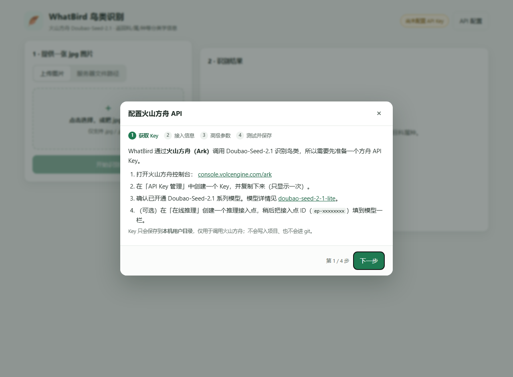
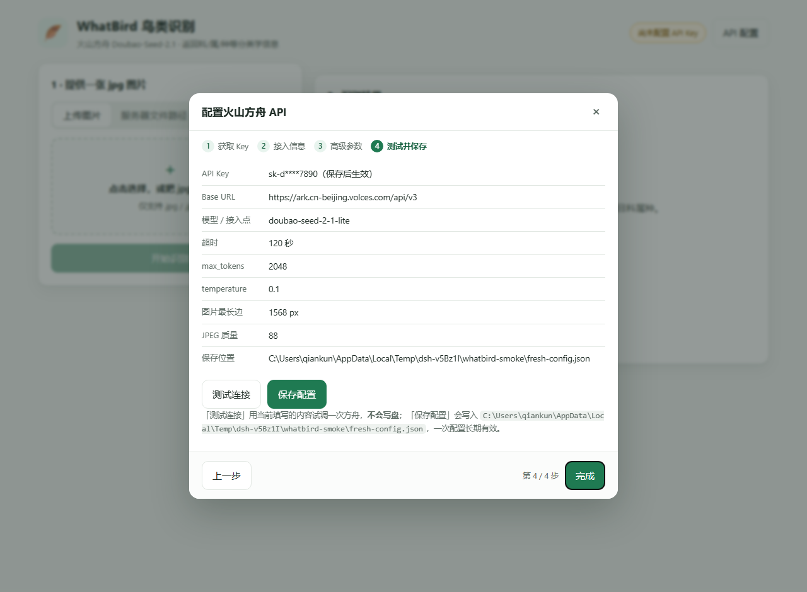

# WhatBird 🪶

基于 **火山引擎方舟 Doubao-Seed-2.1** 的鸟类识别应用：给它一张 jpg 图片，返回鸟的中文名、英文名、
拉丁学名，以及**界 / 门 / 纲 / 目 / 科 / 属 / 种**等完整分类学信息。

项目约定见 [`Agent.md`](Agent.md)（固定载入内容）：Python 工作语言、pip 用清华镜像、
前后端分离、git 版本管理、API 配置隔离且不入库。

---

## 1. 架构

严格的前后端分离，所有业务能力集中在 `core` 层，CLI 与 Web 都只是 `core` 的调用方：

```
        ┌──────────────┐        ┌──────────────┐
        │  CLI (前端)  │        │  Web (前端)  │
        │ whatbird/cli │        │ 静态 HTML/JS │
        └──────┬───────┘        └──────┬───────┘
               │   CLI -> core         │  REST -> core
               │                       │
        ┌──────▼───────────────────────▼───────┐
        │            whatbird/core             │
        │ config / image_input / prompt /      │
        │ ark_client / recognizer / models     │
        └──────────────────┬───────────────────┘
                           │ OpenAI 兼容协议
                  ┌────────▼────────┐
                  │  火山方舟 Ark    │
                  │ Doubao-Seed-2.1 │
                  └─────────────────┘
```

- `whatbird/core` —— 纯业务，不 import 任何 Web 框架；未来接新的 UI（桌面端、Bot…）只需再写一个前端。
- `whatbird/cli.py` —— 命令行前端（`CLI -> core`）。
- `whatbird/web/` —— FastAPI REST 后端 + 静态前端（`UI -> core`）。

```
WhatBird/
├── Agent.md                     # 固定载入约定
├── README.md
├── requirements.txt             # 运行依赖
├── requirements-dev.txt         # 开发/测试依赖
├── pyproject.toml
├── examples/
│   └── config.example.json      # 配置模板（不含真实密钥，可提交）
├── docs/screenshots/            # 界面截图（README 引用）
├── whatbird/
│   ├── core/
│   │   ├── config.py            # 配置读写 + 隔离 + 脱敏
│   │   ├── errors.py            # 统一异常体系
│   │   ├── image_input.py       # jpg 校验 / 压缩 / base64
│   │   ├── prompt.py            # 提示词 + 模型输出解析
│   │   ├── ark_client.py        # 方舟调用（唯一的外部通信点）
│   │   ├── models.py            # 数据契约
│   │   └── recognizer.py        # 门面 BirdRecognizer
│   ├── cli.py                   # CLI 前端
│   └── web/
│       ├── app.py               # FastAPI REST 层
│       └── static/              # 原生 HTML/CSS/JS 前端
└── tests/                       # pytest（core / api / 前端契约）
```

---

## 2. 安装

本机已经在仓库内准备好一个虚拟环境 `E:\WhatBird\.venv`（依赖已装齐），直接用它即可：

```bat
.venv\Scripts\python -m whatbird.cli --help
```

下文命令里的 `python` 都指**这个虚拟环境的解释器**；若你在自己的终端里操作，先激活它
（`.venv\Scripts\activate`）或直接写全路径。

要在别的环境里安装，请使用清华镜像（`Agent.md` 第 2 条）：

```bash
python -m pip install -i https://pypi.tuna.tsinghua.edu.cn/simple -r requirements-dev.txt
```

> 两个已踩过的坑：
> 1. `requirements*.txt` 保持纯 ASCII —— 中文 Windows 上 pip 用 GBK 读取，中文注释会抛 `UnicodeDecodeError`。
> 2. 如果 pip 长时间卡住不动，加上 `--no-cache-dir`（pip 的 HTTP 缓存目录不可写时会一直空转）。


---

## 3. 配置 API（一次配置，长期有效）

### 配置存放在哪里

程序启动时会**真实试写**探测各候选位置，取第一个可写的（界面与 `config doctor` 都会显示结果）：

1. `~/.whatbird/config.json` —— 首选，完全在仓库之外；
2. `%LOCALAPPDATA%\WhatBird\config.json`；
3. `%APPDATA%\WhatBird\config.json`；
4. `<项目>\.whatbird\config.json` —— 仓库内的兜底位置，**必须由你显式同意才会使用**。

第 4 项有三重限制，避免密钥被悄悄放进项目：

- **默认不自动降级**。需要显式同意：向导第 4 步勾选「同意使用项目内位置」，
  或命令行 `whatbird config set --allow-project-config ...`，
  或设置环境变量 `WHATBIRD_ALLOW_PROJECT_CONFIG=1`；
- 必须通过 `git check-ignore` 校验才会启用，所以「不会被提交到 git」由 git 本身保证；
- **读取**不受影响：已经存在别处的配置仍会被读到（界面/CLI 会显示「当前读取自」），
  位置变化不会让你重填 Key。

不是首选位置时，界面和命令行都会明确提示当前用的是哪个位置、以及首选位置**为什么不可写**。

```bash
python -m whatbird.cli config doctor    # 逐个候选位置真实试写，排查「保存失败」
```

向导第 4 步有「重新检测位置」按钮（不必重启进程）；如果位置发生变化
（例如从项目内兜底切回用户目录），已配置的内容仍会被读取，下次保存写入新位置，**不需要重填 Key**。

配置入口有两个，读写的是**同一份文件**，效果完全相同。

### 方式一：Web 配置向导（推荐）

```bash
python -m whatbird.cli serve
```

打开 <http://127.0.0.1:8000>，**首次进入会自动弹出四步配置向导**：

1. **获取 Key** —— 直达方舟控制台的入口，说明需要开通的模型与推理接入点；
2. **接入信息** —— API Key、Base URL、模型 / 推理接入点 ID，带即时校验；
3. **高级参数** —— 超时、max_tokens、temperature、图片最长边、JPEG 质量，可一键恢复默认；
4. **测试并保存** —— 「测试连接」用当前填写的内容试调一次方舟且**不写盘**，确认无误再「保存配置」。



之后随时点右上角「API 配置」可重新进入向导；已保存的 Key 只以脱敏形式回显，留空即表示不修改。

### 方式二：命令行

推荐交互式输入 Key，避免留在命令历史里：

```bash
python -m whatbird.cli config set --api-key -
```

也可以一次写全：

```bash
python -m whatbird.cli config set ^
  --api-key sk-你的方舟APIKey ^
  --base-url https://ark.cn-beijing.volces.com/api/v3 ^
  --model doubao-seed-2-1-lite
```

> 在方舟控制台创建**推理接入点**后，`--model` 也可以填接入点 ID（形如 `ep-2025xxxx-xxxxx`）。

查看 / 校验：

```bash
python -m whatbird.cli config show      # 默认脱敏显示（含配置文件位置与可写性）
python -m whatbird.cli config path      # 配置文件位置
python -m whatbird.cli config doctor    # 逐个候选位置试写，排查「保存失败」
python -m whatbird.cli config verify    # 真的调一次模型，验证 Key/模型是否可用
```

配置项说明（见 [`examples/config.example.json`](examples/config.example.json)）：

| 字段 | 默认值 | 说明 |
| --- | --- | --- |
| `api_key` | 空 | 方舟 API Key（**必需**） |
| `base_url` | `https://ark.cn-beijing.volces.com/api/v3` | 方舟 OpenAI 兼容端点 |
| `model` | `doubao-seed-2-1-lite` | Model ID 或推理接入点 ID |
| `timeout` | `120` | 单次请求超时（秒） |
| `max_tokens` | `2048` | 回答长度上限 |
| `temperature` | `0.1` | 越低越稳定，识别任务建议保持低值 |
| `max_image_side` | `1568` | 图片最长边，超出则等比缩小（省 token） |
| `jpeg_quality` | `88` | 重编码 JPEG 质量 |

高级用法：设置环境变量 `WHATBIRD_CONFIG_FILE`（或 `WHATBIRD_CONFIG_DIR`）可把配置文件放到别处，
**但放在仓库内会被直接拒绝**——这是防止密钥入库的硬保护。

---

## 4. 使用方式一：命令行（CLI -> core）

```bash
python -m whatbird.cli identify D:\photos\bird.jpg
```

输出示例：

```
────────────────────────────────────────────────────────────
  白鹡鸰  Motacilla alba
  英文名：White Wagtail
  置信度：93%
────────────────────────────────────────────────────────────
分类学信息
  界  动物界 Animalia
  门  脊索动物门 Chordata
  纲  鸟纲 Aves
  目  雀形目 Passeriformes
  科  鹡鸰科 Motacillidae
  属  鹡鸰属 Motacilla
  种  白鹡鸰 Motacilla alba

识别依据
  1. 黑白灰配色，喉部黑色
  2. 尾羽细长且不停摆动
...
元数据：模型 doubao-seed-2-1-lite ｜ 图片 D:\photos\bird.jpg ｜ 耗时 3.42s
```

机器可读输出：

```bash
python -m whatbird.cli identify D:\photos\bird.jpg --json
python -m whatbird.cli identify D:\photos\bird.jpg --json --raw   # 附带模型原始返回
```

---

## 5. 使用方式二：Web 界面（UI -> core）

```bash
python -m whatbird.cli serve --port 8000
```

浏览器打开 <http://127.0.0.1:8000>：

- 首次进入自动弹出**配置向导**（四步：获取 Key → 接入信息 → 高级参数 → 测试并保存）；
- 之后点右上角「API 配置」可随时回到向导修改，已保存的 Key 不会明文下发到浏览器；
- 提供图片有两种方式：**上传图片** 或 **填写服务器上的 jpg 路径**；
- 结果区展示中文名、学名、置信度、界门纲目科属种、识别依据、相似物种等。



### REST 接口

| 方法 | 路径 | 说明 |
| --- | --- | --- |
| GET | `/api/health` | 健康检查 + 是否已配置 |
| GET | `/api/config` | 读取配置（Key 脱敏）+ 参数默认值 + 位置与可写性 |
| PUT | `/api/config` | 写入配置 |
| POST | `/api/config/verify` | 测试连接；请求体可带「草稿」参数，**只测不存** |
| POST | `/api/recognize` | 上传图片识别（multipart） |
| POST | `/api/recognize-path` | 传入服务器 jpg 路径识别 |
| GET | `/docs` | 自动生成的 OpenAPI 文档 |

> 会改动状态或消耗额度的接口都要求请求头 `X-WhatBird-Client: 1`。
> 浏览器跨站请求无法自定义该请求头（会触发 CORS 预检被拦下），可防止恶意网页偷偷调用本机服务。

```bash
curl -X POST http://127.0.0.1:8000/api/recognize-path ^
  -H "Content-Type: application/json" ^
  -H "X-WhatBird-Client: 1" ^
  -d "{\"path\": \"D:\\\\photos\\\\bird.jpg\"}"
```

---

## 6. 测试

```bash
python -m pytest
```

- 全部使用假客户端（`FakeRecognizer`）与临时配置目录，**不联网、不消耗额度、不接触真实配置**；
- `tests/test_frontend.py` 做**前端契约检查**：JS 里引用的元素 id / 类名 / 接口路径必须真实存在，
  并守住「`hidden` 必须真的隐藏」这条样式兜底规则 —— 这类问题不会有编译期报错，
  却会让向导整页点不动或遮罩一直挡住界面。

---

## 7. 安全与 git

- API Key 只存在于 `~/.whatbird/config.json`（用户目录），**不在仓库内**；
- `save_config()` 会拒绝把配置写进仓库目录；
- 所有对外输出（API 响应、CLI 展示、日志）默认使用脱敏 Key；
- `.gitignore` 额外忽略 `config/*.json`、`.env`、`*.key` 等，作为兜底。

---

## 8. 常见问题

| 现象 | 原因与处理 |
| --- | --- |
| 保存配置报「拒绝访问 / WinError 5」 | 程序被限制写用户目录（受限沙箱、受限终端或安全软件）。程序**不会自动**把配置放进项目里；向导第 4 步会给出可写位置并请你确认同意。先跑 `python -m whatbird.cli config doctor` 看每个位置的具体原因 |
| `HTTP 401 鉴权失败` | API Key 不对或失效，重新 `config set` |
| `HTTP 404 模型或接入点不存在` | `model` 填错：应填控制台 Model ID 或 `ep-xxxxxxxx` 接入点 ID |
| `HTTP 400 请求被方舟拒绝` | 常见于模型不支持图片输入、图片过大 |
| `HTTP 429 触发限流` | 稍后重试，或降低调用频率 |
| 后缀是 jpg 但报「无法解析」 | 文件损坏或只是改了后缀，`Pillow` 在本地就拦下了 |
| 结果里分类学信息为空 | 模型没给出，可重试；识别结果仅供参考，请结合实际观察 |

---

## 9. 已知边界（第一版）

- 仅接受 `.jpg / .jpeg`（`Agent.md` 第 6 条），其他格式会给出明确提示；
- 单次只识别一张图、图中一只主鸟；
- 识别结果由大模型生成，**不构成严谨的物种鉴定结论**。
